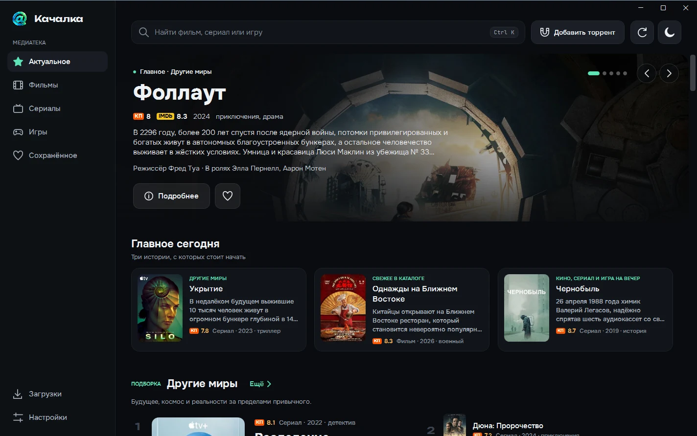

# Качалка

Нативное приложение для Windows и macOS: фильмы, сериалы и каталог игр для Windows, поиск раздач и общая очередь torrent- и magnet-загрузок. Windows использует WPF, Mac — SwiftUI и AppKit. Без Electron и встроенного браузера.

**[Скачать последнюю опубликованную версию](https://github.com/peregond/ka4alka/releases/latest)** · [Скриншоты](distribution/README.md) · [Новости](https://t.me/ka4alkacc) · [Чат поддержки](https://t.me/+6sT2ocaKvLxlNmRi)

[](distribution/README.md)

[Скриншоты Windows и Mac на русском и английском — версия 0.44.27](distribution/README.md)

## Windows и Mac · 0.44

Одна версия, общая логика и одновременный выпуск: установщик/ZIP для Windows x64, DMG/ZIP для Mac на Apple Silicon и Intel. Публикация проходит только после проверок обеих платформ. [Архитектура, сборка и установка Mac](distribution/MACOS.md).

На Mac доступны каталог, Steam, поиск и раздачи, сохранённое и скрытие, очередь и файлы, диагностика, восстановление сети, уведомления и связь с Windows-компьютерами. Игровые файлы остаются версиями **для Windows**; Mac не запускает их установщики.

Windows 10/11 x64 или macOS 14+. В Mac-пакетах пока используется ad-hoc подпись, без нотариализации Apple; при первом запуске может потребоваться разрешение Gatekeeper. Подробности — в инструкции установки.

## Актуальное

Курируемые подборки фильмов, сериалов и игр на одной странице — когда хочется выбрать что-нибудь интересное без поискового запроса. Из подборки можно открыть карточку, сохранить произведение или скрыть его из ленты.

## Фильмы и сериалы

Каталог с постерами, горизонтальными баннерами, описаниями, оценками и участниками при наличии данных. Общий поиск находит фильмы и сериалы по русским, английским и альтернативным названиям; результаты можно ограничить одним разделом.

- Подборки популярных и новых произведений, фильтры жанра, страны, рейтинга, года и качества.
- Рекомендации учитывают найденные варианты загрузки. Доступность участников конкретной раздачи проверяется отдельно.
- Выбор сезона и серии, фильтры по студии и типу озвучки, субтитрам и источнику.
- Качество отмечено на постере: HD Ready, Full HD, 4K или «Экранка». Плохое качество скрыто по умолчанию.
- Общее «Сохранённое», скрытие отдельных названий и жанров с восстановлением в настройках.

## Игры для Windows · новое в 0.42

Отдельный раздел с популярными играми и новинками Steam, поиском и страницами каталога. Главная раздела устроена как у фильмов и сериалов: баннер с широкой картинкой Steam и восемь подборок — популярное, со скидкой, новинки, скоро выйдут и четыре жанровых, с кнопкой «Ещё», сортировками и лентой жанров под поиском. На карточках видны цена, скидка и доля положительных отзывов Steam. Бесплатные игры в подборки не попадают, поиск по названию находит любую игру. В карточке — галерея скриншотов, описание, разработчик, издатель, отзывы, оценка Metacritic, цена со скидкой, статус русского языка и системные требования; раздачи показаны так же, как у фильмов, с рекомендованной раздачей наверху. Для каталога не нужны аккаунт Steam или API-ключ.

Раздачи ищутся в RuTor, RuTracker через Knaben и настроенных PC-индексаторах Torznab. Известные консольные и Mac/Linux-издания, другие части и отдельные обновления отсекаются. Игры сохраняются вместе с фильмами и сериалами и скачиваются в общей очереди. Из очереди можно вернуться в карточку игры.

Кнопки Steam и SteamDB открывают соответствующие страницы. SteamDB не используется для автоматического сбора данных; IGDB не подключён. Скачивание игры не запускает её установщик автоматически.

## Загрузки и устройства

Компактная очередь с обложками, прогрессом, скоростью и участниками. Доступны пауза и продолжение, общее управление загрузкой и отдачей, лимиты скорости, сортировка и подробный список файлов. «Удалить из загрузок» сохраняет файлы; «Удалить файлы» удаляет их отдельно.

При первом запуске приложение предлагает выбрать папку и создаёт в ней `Ka4alka`. Очередь и настройки сохраняются в `%LOCALAPPDATA%/Kachalka` на Windows и `~/Library/Application Support/Kachalka` на Mac. Есть диагностика проблем загрузки, сбор логов, уведомления, контроль свободного места и восстановление соединений после обрыва сети.

Раздачу можно отправить на другой компьютер в домашней IPv4-сети. Включите «Устройства в сети» на обоих компьютерах, найдите устройство автоматически или по адресу и подтвердите одинаковый код. Получатель использует собственную папку и лимиты; доверие можно отозвать. Передача задания защищена TLS, аккаунт не нужен. Для связи может понадобиться разрешение брандмауэра в частной сети.

## Интерфейс и производительность

Язык интерфейса можно переключить между русским и английским в «Настройки → Внешний вид → Язык интерфейса». В английском интерфейсе поиск предпочитает английские названия, а раздачи и рекомендации — английскую озвучку. Альтернативы на других языках остаются доступны; порядок раздач можно изменить вручную. Выбор языка сохраняется и применяется без перезапуска; названия фильмов, торрентов и поисковые запросы остаются исходными.

Тёмная тема включена по умолчанию; светлая выбирается в настройках. Окно адаптируется к размеру и масштабированию Windows. Поиск остаётся доступен в карточках и загрузках.

Карточки виртуализированы, изображения загружаются возле видимой области и сохраняются в ограниченном кэше. Запросы отменяются при уходе со страницы; одинаковые запросы объединяются. Метаданные и раздачи появляются по мере готовности, без ожидания всех источников. Лёгкий режим ограничивает фоновую работу и память и отключает декоративные анимации; его можно выбрать вручную.

## Установка и обновления

Скачайте пакет из [последнего релиза](https://github.com/peregond/ka4alka/releases/latest): `.exe` для Windows x64 или DMG для своего Mac (Apple Silicon / Intel). На Mac перетащите Ka4alka в Applications; SDK или отдельный .NET устанавливать не нужно. Номер версии указан в настройках; там же доступны автозапуск, проверка обновлений и перезапуск для установки.

Обновления приходят с GitHub. Загружаются изменившиеся компоненты, подпись и SHA-256 проверяются до установки; при неудачном запуске предусмотрен откат. Настройки, очередь и скачанные файлы сохраняются. Автоматическую проверку и установку можно отключить.

## С телефона в домашней сети

Настройки → Устройства в сети → **Подключить телефон**. Отсканируй QR-код камерой телефона в той же домашней Wi-Fi сети: браузер (включая Safari на iPhone) подключится без ручного ввода. QR одноразовый, действует две минуты; обычная ссылка и ручной код тоже доступны. Ищи фильмы, сериалы и игры, выбирай раздачи или вставляй magnet-ссылки. Во вкладке «Загрузки» можно поставить задачу на паузу, продолжить или явно подтвердить повторное скачивание удалённых файлов. Приложение должно оставаться запущенным; доступ отзывается одной кнопкой. [Инструкция и устройство локального доступа](distribution/PHONE-REMOTE-HANDOFF.md).

Телефонный интерфейс оформлен в стилистике iOS: нижняя навигация, светлая и тёмная темы, карточки с оценками и панель новой magnet-загрузки. Можно фильтровать раздачи по качеству и озвучке, сортировать по раздающим или размеру и смотреть реальные проценты и скорости в очереди. Возврат в каталог сохраняет поиск и прокрутку. Страница встроена в обе версии приложения и не выполняет фоновый опрос компьютера.

## Источники и ограничения

Метаданные фильмов и сериалов поступают из каталога «Ка4алка Онл@йн», Zona, TMDB и TheTVDB по доступности; игровой каталог — из Steam. Для поиска раздач используются публичные источники, в том числе RuTor, NNM-Club, MegaPeer, BigFanGroup, RuTracker через Knaben, Internet Archive, EZTV и Nyaa по применимости. Сайт и его копии помогают при недоступности прямых источников.

Наличие карточки не гарантирует наличие подходящей раздачи или активных участников. Источники могут ограничивать доступ по региону или менять формат ответа. Отсутствующие оценки, озвучка и требования не заменяются вымышленными значениями. Используйте приложение для материалов, которые вы вправе скачивать и распространять.

## Разработка

Интерфейс Windows — в `native/`, Mac — в `macos/`, общий движок — в `desktop-core/` и `desktop-host/`, сайта — в `web-index/`, локальной сети — в `lan-core/`, обновлятора Windows — в `update-core/` и `updater/`, Mac — в `mac-update-core/`. Нужны Windows и .NET 10 SDK для запуска WPF; серверная часть использует Node.js и lockfile npm.

```powershell
./build.ps1 -Test
dotnet run --project lan-tests/Kachalka.LanTests.csproj -c Release
dotnet run --project update-tests/Kachalka.UpdateTests.csproj -c Release
```

Windows CI проверяет установщик, сохранение настроек, подписанное обновление и настоящий WPF-интерфейс. Проверки игр и отзывчивости выполняются также с ограничением .NET до двух и четырёх процессоров. Это проверка конкретных сценариев, а не обещание одинаковой скорости на любом компьютере.

[История выпусков](https://github.com/peregond/ka4alka/releases) · [Документация сайта](web-index/README.md) · [Получение скриншотов](scripts/screenshots/README.md)

Качалка использует [MonoTorrent](https://github.com/alanmcgovern/monotorrent), [QRCoder](https://github.com/Shane32/QRCoder) для Windows, шрифты [Onest](native/Fonts/Onest-OFL.txt), [Unbounded](native/Fonts/Unbounded-OFL.txt) и [JetBrains Mono](native/Fonts/JetBrainsMono-OFL.txt) по SIL OFL 1.1 и официальные [некоммерческие наборы оценок IMDb](https://developer.imdb.com/non-commercial-datasets/). Лицензии зависимостей включены в сборку.
