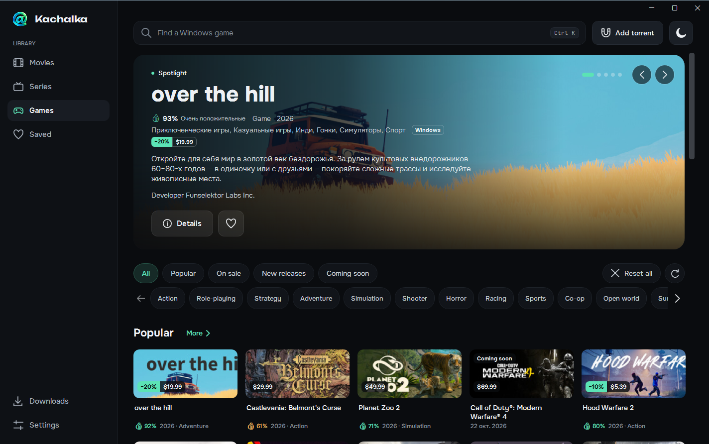
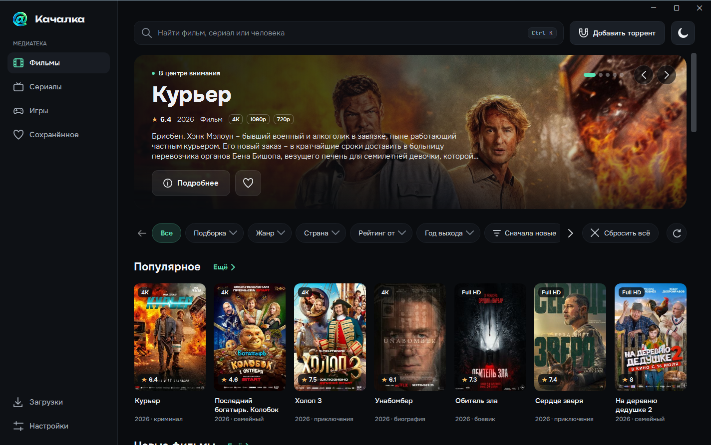

# Качалка · 0.43.4

Нативное приложение для Windows: фильмы, сериалы и игры для Windows, поиск раздач и общая очередь torrent- и magnet-загрузок. Без Electron и встроенного браузера.

**[Скачать установщик 0.43.4 для Windows x64](https://github.com/peregond/ka4alka/releases/download/v0.43.4/Kachalka-Setup-0.43.4.exe)**

[Все выпуски](https://github.com/peregond/ka4alka/releases) · [Описание возможностей](../README.md) · [Новости](https://t.me/ka4alkacc) · [Поддержка](https://t.me/+6sT2ocaKvLxlNmRi)

## Скриншоты опубликованной 0.43.4

Настоящий WPF-интерфейс Windows из проверенного опубликованного пакета. Русский и английский наборы сняты отдельно с соответствующей настройкой языка; приложение и содержимое карточек не подменялись. Версия, SHA-256 пакета и DLL и сведения о загрузке постеров сохранены в [метаданных захвата](assets/0.43.4/capture-0.43.4.json).

| Раздел | Русский | English |
| --- | --- | --- |
| Фильмы | [Тёмная тема](assets/0.43.4/ru/catalog-dark.png) · [Светлая](assets/0.43.4/ru/catalog-light.png) | [Dark](assets/0.43.4/en/catalog-dark.png) · [Light](assets/0.43.4/en/catalog-light.png) |
| Сериалы | [Открыть](assets/0.43.4/ru/series-dark.png) | [TV shows](assets/0.43.4/en/series-dark.png) |
| Игры | [Тёмная тема](assets/0.43.4/ru/games-dark.png) · [Светлая](assets/0.43.4/ru/games-light.png) | [Dark](assets/0.43.4/en/games-dark.png) · [Light](assets/0.43.4/en/games-light.png) |
| Карточка фильма | [Открыть](assets/0.43.4/ru/detail-dark.png) | [Movie details](assets/0.43.4/en/detail-dark.png) |
| Загрузки | [Открыть](assets/0.43.4/ru/downloads-dark.png) | [Downloads](assets/0.43.4/en/downloads-dark.png) |
| Настройки | [Открыть](assets/0.43.4/ru/settings-dark.png) | [Settings](assets/0.43.4/en/settings-dark.png) |

### Игры для Windows

### Фильмы и описания в баннерах

### Материалы для лендинга

Оригиналы PNG находятся в `assets/0.43.4/ru/` и `assets/0.43.4/en/`. Лендинги в `landing/` и `web-index/` используют WebP без изменения содержимого: русский сайт показывает русский интерфейс, английский и испанский — английский. Галерея включает фильмы, сериалы, игры, карточку фильма, загрузки и светлую тему. [Текст описания](LANDING-COPY.md) · [Получение скриншотов](../scripts/screenshots/README.md).

## Установка

Запустите `.exe` и выберите папку для загрузок при первом запуске: приложение создаст в ней `Ka4alka`. Тёмная тема включена по умолчанию, светлая выбирается в настройках. Номер версии, автозапуск и обновления находятся там же.

Приложение проверяет обновления на GitHub и скачивает изменившиеся компоненты. Пакеты проверяются по подписи и SHA-256 до установки; настройки, очередь и скачанные файлы сохраняются. Проверку и автоматическую установку можно отключить.

## Примечания

Наличие карточки не гарантирует подходящую раздачу или активных участников. Доступность Steam и торрент-источников зависит от региона и сети. Игровые установщики не запускаются автоматически. Используйте приложение для материалов, которые вы вправе скачивать и распространять.

[Что изменилось в 0.43.4](RELEASE-NOTES-0.43.4.md), [в 0.43.3](RELEASE-NOTES-0.43.3.md), [в 0.43.2](RELEASE-NOTES-0.43.2.md), [в 0.43.1](RELEASE-NOTES-0.43.1.md), [в 0.43.0](RELEASE-NOTES-0.43.0.md), [в 0.42.2](RELEASE-NOTES-0.42.2.md), [в 0.42.1](RELEASE-NOTES-0.42.1.md) и [в 0.42.0](RELEASE-NOTES-0.42.0.md). Лицензии используемых компонентов находятся в папке `licenses` сборки.
