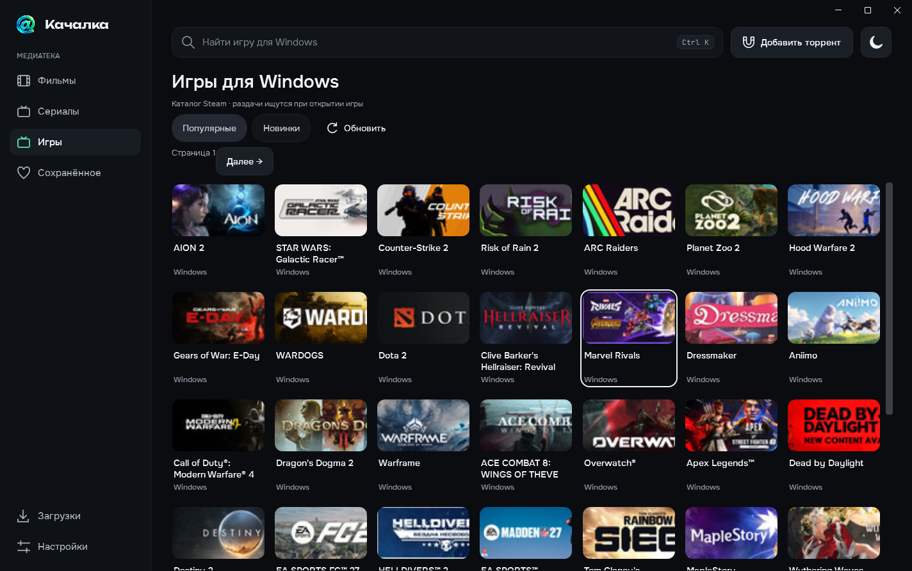
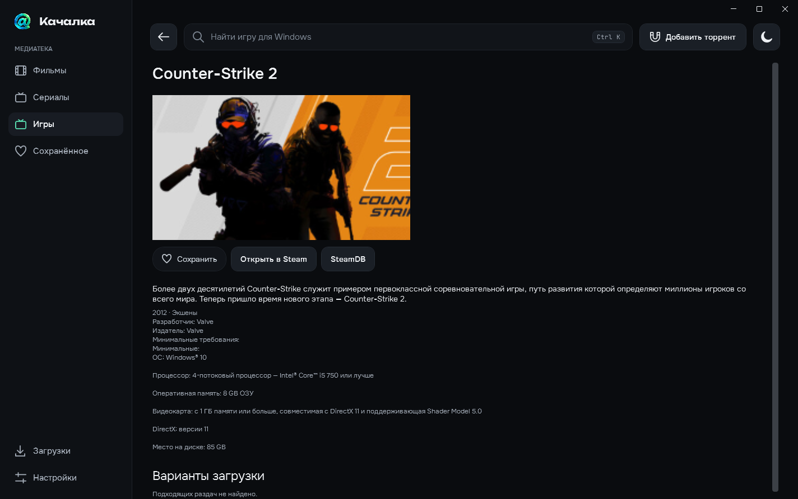
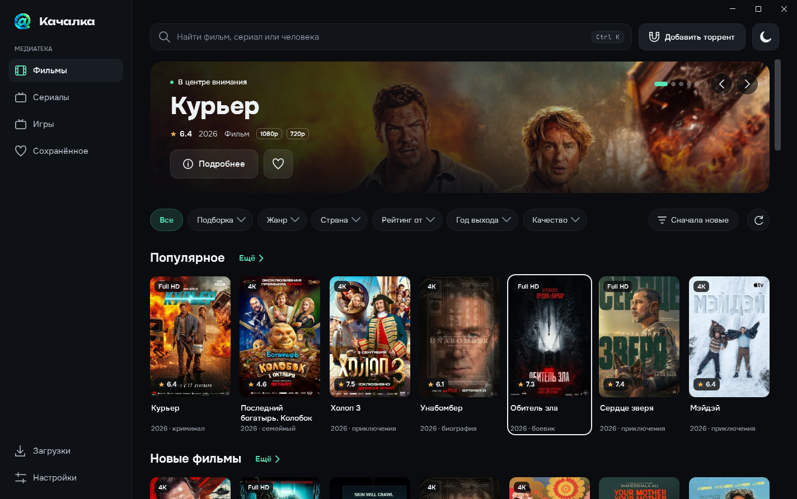
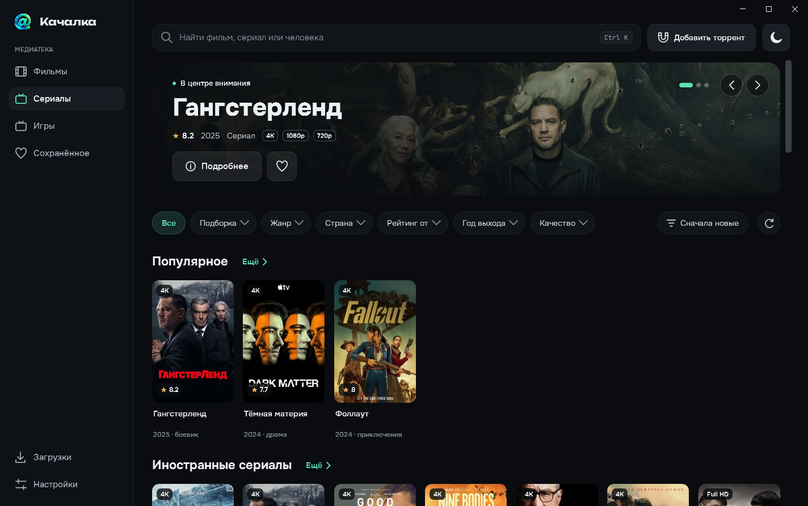
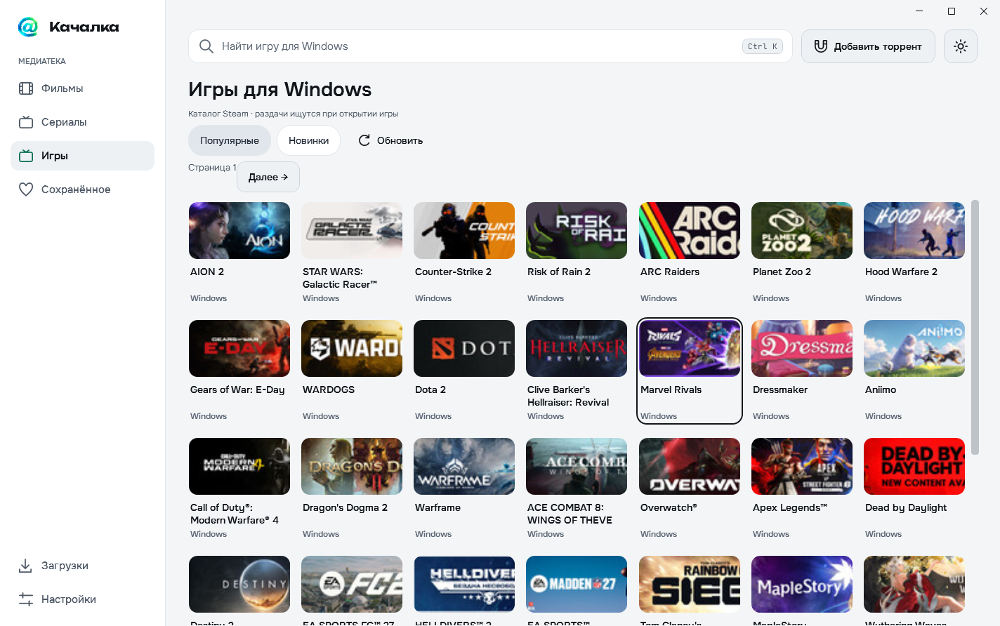
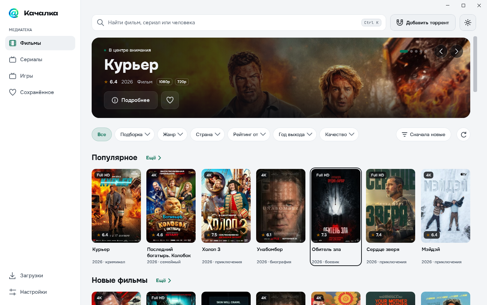
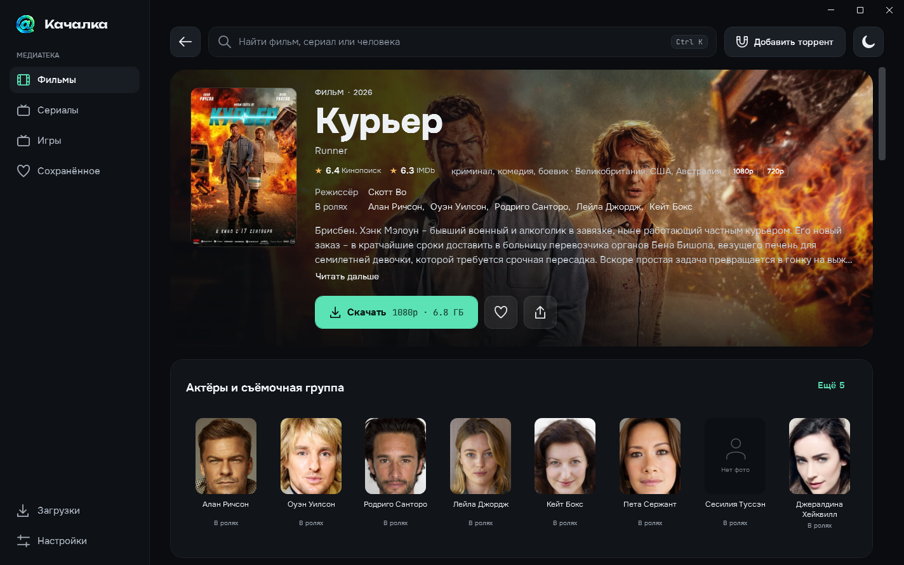
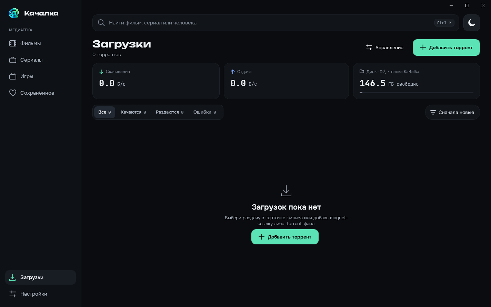
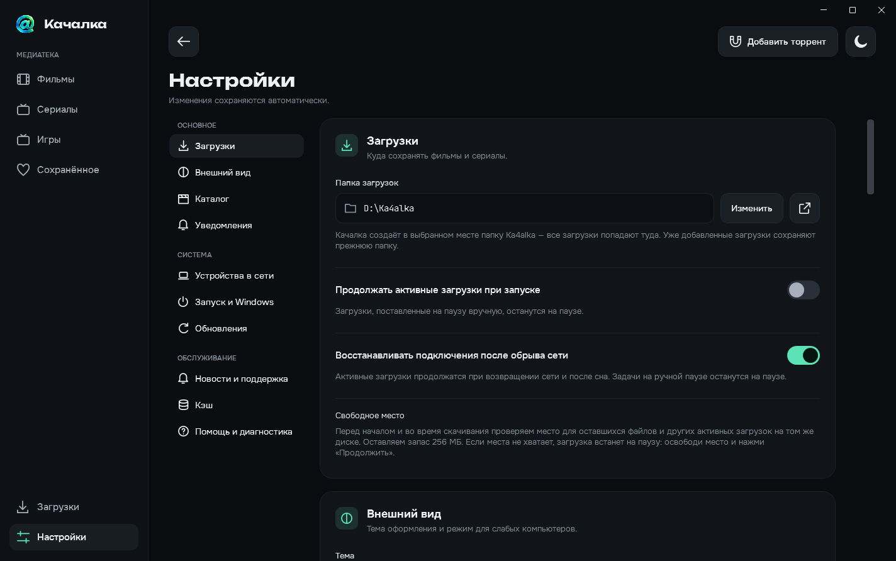

# Качалка · 0.42.0

Нативное приложение для Windows: фильмы, сериалы и игры для Windows, поиск раздач и общая очередь torrent- и magnet-загрузок. Без Electron и встроенного браузера.

**[Скачать установщик 0.42.0 для Windows x64](https://github.com/peregond/ka4alka/releases/download/v0.42.0/Kachalka-Setup-0.42.0.exe)**

[Все выпуски](https://github.com/peregond/ka4alka/releases) · [Описание возможностей](../README.md) · [Новости](https://t.me/ka4alkacc) · [Поддержка](https://t.me/+6sT2ocaKvLxlNmRi)

## Скриншоты опубликованной 0.42.0

Снимки настоящего WPF-интерфейса опубликованной версии в Windows. Каталог и карточка игры используют живые данные Steam. Версия и SHA-256 пакета зафиксированы в [метаданных захвата](assets/0.42/capture-0.42.0.json).

### Игры для Windows

Популярные игры и новинки Steam, поиск и переход к описанию и раздачам.

### Карточка игры

Описание, разработчики, минимальные системные требования и результат поиска раздач. Steam и SteamDB открываются отдельными кнопками.

### Фильмы

### Сериалы

Светлая тема, карточка фильма, загрузки и настройки

### Игры — светлая тема

### Фильмы — светлая тема

### Карточка фильма

### Загрузки

Очередь в изолированном профиле без добавленных заданий.

### Настройки

## Материалы для лендинга

Используйте PNG из `assets/0.42/` и [готовый текст описания](LANDING-COPY.md). Каталог игр и карточка игры подходят для представления нового раздела; остальные снимки показывают актуальное оформление приложения. [Порядок получения скриншотов](../scripts/screenshots/README.md).

## Установка

Запустите `.exe` и выберите папку для загрузок при первом запуске: приложение создаст в ней `Ka4alka`. Тёмная тема включена по умолчанию, светлая выбирается в настройках. Номер версии, автозапуск и обновления находятся там же.

Приложение проверяет обновления на GitHub и скачивает изменившиеся компоненты. Пакеты проверяются по подписи и SHA-256 до установки; настройки, очередь и скачанные файлы сохраняются. Проверку и автоматическую установку можно отключить.

## Примечания

Наличие карточки не гарантирует подходящую раздачу или активных участников. Доступность Steam и торрент-источников зависит от региона и сети. Игровые установщики не запускаются автоматически. Используйте приложение для материалов, которые вы вправе скачивать и распространять.

[Что изменилось в 0.42.0](RELEASE-NOTES-0.42.0.md). Лицензии используемых компонентов находятся в папке `licenses` сборки.
